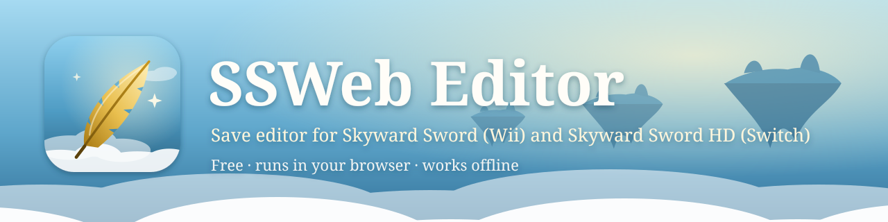

<p align="center"></p>

# SSWeb Editor

A browser-based save editor for The Legend of Zelda: Skyward Sword (Wii) and Skyward Sword HD (Switch).

- **Use it online:** https://libra2393.github.io/SSWeb-Editor/
- **Use it offline:** [download SSWeb-Editor.html](https://github.com/Libra2393/SSWeb-Editor/releases/latest/download/SSWeb-Editor.html) (the whole editor in one file). Double-click it to open it
  in your browser; it works with no internet and no install, on Windows, Linux or macOS. Every release is listed
  under [Releases](https://github.com/Libra2393/SSWeb-Editor/releases).

Edits the raw `wiiking2.sav` that Dolphin stores unencrypted under `Wii/title/00010000/534f55xx/data/`, and
the Skyward Sword HD save from the Switch. Everything the editor knows about the formats lives in
`defs/*.json`.

Unofficial fan project, not affiliated with or endorsed by Nintendo. No Nintendo code, assets or keys are
included.

## Running

Serve the folder (browsers won't `fetch` JSON from `file://`):

```
python3 -m http.server -d ss-save-editor-web 8000
```

Then open http://localhost:8000.

### Offline / standalone version (Windows, Linux, macOS)

`tools/build_standalone.py` packs the whole editor (code, styles and every file in `defs/`) into a single
`dist/SSWeb-Editor.html` that works with no internet and no install: download it, double-click it, and it opens in
your browser. It needs only Python 3 to build:

```
python3 tools/build_standalone.py
```

Rebuild it whenever `defs/` or the code changes; the footer shows the build's commit and date. To share it, attach
the file to a GitHub Release (**Releases → Draft a new release**) rather than committing it (`dist/` is ignored).
In Chrome and Edge, **Save** writes back to the opened file; Firefox downloads a copy instead. The GPL text and the
credits are embedded in the file, so every copy carries its license.

### Publishing on GitHub Pages

The editor is static files only, so GitHub Pages can serve this folder as it is: push it to a repository, then
under **Settings → Pages** choose **Deploy from a branch**, branch `main`, folder `/ (root)`. The `.nojekyll`
file makes Pages serve every file unchanged. If you open `index.html` straight from disk, use **⋯ → Load definitions folder** and pick `defs/`.

In Chromium-based browsers, **Save** writes back to the file you opened. Other browsers download a copy instead.
Changed slots get their CRC32 recomputed on save. Close the game in Dolphin first.

## Definition files

`defs/manifest.json` lists the files to load:

```json
{ "layout": "layout.json", "enums": ["enums.json"], "sections": ["general.json", "..."] }
```

**layout.json** describes the file shape: `fileSize`, `endian`, the `magic` game IDs, and named **scopes**
(`base`, `size`, optional `stride` and `count` for repeated blocks like the 3 save slots). `checksums` lists
`{scope, algorithm: "crc32", start, length, store}`. All offsets can be numbers or `"0x…"` strings.

**Section files** each become a tab:

```json
{
  "id": "inventory", "title": "Inventory", "scope": "slot",
  "layout": "flags",            // optional: compact checkbox grid with a filter box
  "groups": [
    { "title": "Swords", "columns": 3, "fields": [ ... ] }
  ]
}
```

`scope` is inherited section → group → field. Field offsets are relative to the scope's base.

| `type` | Extra keys | Notes |
| --- | --- | --- |
| `u8` `u16` `u32` `u64` `s8` `s16` `s32` | `shift`, `bits`, `min`, `max`, `enum`, `hex`, `unit` | `shift`/`bits` reads a packed bitfield and leaves the other bits alone |
| `f32` `f64` | | |
| `flag` | `mask`, `storage` (default `u8`) | checkbox, set when all bits in `mask` are set |
| `bool` | `storage` | non-zero is true, writes 1/0 |
| `string` | `length` (bytes), `encoding` (`ascii`, `utf16be`, `utf16le`), `options` | null-terminated, and bytes after the terminator are kept |
| `duration` | `tickRate`, `storage` (default `u64`) | edited as h:mm:ss |
| `wiitime` | `tickRate` | Wii clock ticks since 2000-01-01 |
| `row` | `fields` | puts several fields on one line, e.g. owned + count |
| `storyflag` | `flag` (number) | a story flag by its game number, e.g. `{ "type": "storyflag", "flag": 3 }` (Goddess Sword acquired) |
| `itemflag` | `flag` (item ID) | an item's owned flag, e.g. `177` (Emerald Tablet) |
| `sceneflag` | `scene` (name or index), `flag` | a scene flag, e.g. `{ "scene": "Skyloft", "flag": 8 }` |
| `chestflag` | `scene`, `flag` | a chest's opened flag (the game's per-scene chest array), e.g. `{ "scene": "Sky", "flag": 6 }` |

The three flag types are looked up in `defs/flags/` and become ordinary 16-bit flag fields, so they work in both
byte orders. Counters (multi-bit story flags) become number inputs. The story and item tables were read from the
game's own `StoryflagManager`/`ItemflagManager` definition tables; they're identical in HD v1.0.0 and v1.0.1 and
match every story flag the decompilation lists for the Wii. Names come from the
[zeldaret/ss](https://github.com/zeldaret/ss) decompilation (CC0).

### Formats

`manifest.json` lists the file formats under `formats`; each has an `id`, a `label` and its own `layout`. A file is
matched to a format by its size (then by its header if two formats share a size). The sections are shared: every
format gets its own copy, validated against its layout.

| Format | File | Notes |
| --- | --- | --- |
| `wii` | `layout.json`, 0xFBE0 bytes, big-endian | 3 slots, CRC32 per slot |
| `hd` | `layout-hd.json`, 0x1DE20 bytes, little-endian | 4 slots with the same struct, plus two per-slot blocks of HD-only data later in the file. Each slot's CRC32 runs over the slot and then both of its blocks (`parts`) |

Because the formats differ in byte order, flags that live in the game's 16-bit flag arrays (story, item, dungeon
and scene flags, `0x8E4`–`0x2A63`) are defined as `"storage": "u16"` at the even offset, and packed values are
defined on the 16-bit words the game uses. That reads correctly in both byte orders. `"encoding": "utf16"` follows
the layout's byte order. Timestamps (`wiitime`) take an optional `epoch` (default `2000-01-01`).

A checksum can span several ranges: `parts` lists `{scope, start, length}` pieces that are fed through the
algorithm in order, each scope taken at the checksum's slot index. A scope's `companions` are the other per-slot
scopes that belong to it, so copying, reverting and change-tracking a slot carry them along. A checksum with an
`algorithm` the editor doesn't know shows as "checksum unknown" and is never rewritten.

### Variants


The editor opens NTSC-U (`SOUE`), PAL (`SOUP`), NTSC-J (`SOUJ`) and Korean (`SOUK`) saves. These are the game
IDs in `layout.json`'s `magic.values`; add one there to accept another. All regions currently share one layout.
If a format or region differs, give the field a `variants` map keyed by format id (`"hd"`) or game ID (`"SOUJ"`).
Each entry replaces keys of the field there, later keys win (format first, then game ID), and `null` hides the
field. (`regions` is accepted as an older name.)

```json
{ "id": "rupees", "type": "u16", "offset": "0x0A5E",
  "variants": { "hd": { "description": "…" }, "SOUJ": { "offset": "0x0A5C" }, "SOUK": null } }
```

Overrides are applied when a file loads, and again if you change its Game ID on the General tab. Dolphin keeps
each region's save in its own folder (`title/00010000/534f55xx`), and the header bar shows which one the file
belongs in.

### Presets

Presets are listed under `presets` in the manifest and appear next to the slot tools as **Apply preset**. A preset
writes a list of values into the selected slot and leaves everything else alone:

```json
{ "id": "…", "title": "…", "description": "…", "scope": "slot",
  "apply": [
    { "field": "general.isNew", "value": false },
    { "field": "general.playerName", "value": "Link", "onlyIfEmpty": true },
    { "type": "storyflag", "flag": 3, "value": true }
  ] }
```

`field` names an existing field by key; any other entry is an inline field (usually a flag reference).
`"extends": "<preset id>"` starts from another preset's entries and adds its own after them, so they win; the
"starting clothes" preset is the prologue preset plus one entry that turns the knight uniform off. The
included preset, `skyloft-before-first-dive`, puts a file at the end of the prologue for practice: Wing Ceremony
won, Goddess Sword, Sailcloth and Emerald Tablet, Faron light pillar open, 6 hearts, loading on Skyloft. Its
story flags come from the decompilation's descriptions and the Skyward Sword Randomizer's start flags; the
spawn values come from a real HD save made on Skyloft. **It has not been tested in the game yet.**

Every field needs an `id` that is unique within its section, plus a `label`. `description` shows as a tooltip.
`enum` names a table in `enums.json`, keyed by decimal or `"0x"` values.

Mistakes in the definitions (unknown type, offset past the end of the scope, missing enum) show as warnings in
the footer, and the field is skipped. **⋯ → Add definition file** loads an extra section JSON at runtime without
touching `defs/`, which is handy for trying out new findings. The **Raw bytes** tab shades the bytes that some
definition covers, and its Inspect box reads or writes any type at any offset.

## Comparing saves (finding new values)

**⋯ → Compare with another save…** opens a second save of the same format and compares the selected slot with
any slot in it (so a file can be compared with its own autosave). The **Compare** tab lists:

- **Known values that changed**, by name, with before → after.
- **Changes not in the editor yet**, decoded with the game's flag tables: story and item flags by number (often
  with a name from the decompilation), scene and chest flags with their area, and anything else as byte ranges
  labelled with the save-map region. **Copy definition** puts ready-made JSON on the clipboard for a new field.
- The stage and room each save was made in, so changes can be tied to a place.

Play time, save time, positions, facing and the checksum change on every save, so they're hidden unless you
untick **Hide noise**. For clean results, save just before one action, do it, save again, and compare.

## Coverage tracker

The **Coverage** tab shows how much of the save the editor understands, and what's still missing:

- **Save map:** every region of a slot as named by the decompilation, with the share of its bits that some field
  describes. Flags count bit by bit, so the story-flag array shows how many of its 1201 flags are editable. It
  updates automatically as definitions are added.
- **Wishlist:** things players are likely to want to edit, from `defs/tracker.json`. An item that lists `fields`
  is marked *in editor* automatically once all of them exist; otherwise it keeps its `status`: `known` (location
  known, not yet a field), `research` or `not-possible`. Add an item there to track a new request.

## Importing Wii SD-card exports

Saves the Wii copied to an SD card (`data.bin`, or files like `….24871.bin`) are encrypted. Opening one shows an
import dialog. You enter the Wii SD key and IV, confirm the save is your own, and the editor decrypts it in the
browser and opens the `wiiking2.sav` inside (and offers its `skip.dat` under **⋯**). From then on it behaves like
any raw save, and **Save always downloads a raw `wiiking2.sav`** for Dolphin.

## Legal (United States)

This is not legal advice. If you're unsure, ask a lawyer.

- **DMCA anti-circumvention (17 U.S.C. § 1201).** It is unlawful to get around a technological measure that
  controls access to a copyrighted work, and to make or distribute tools primarily designed to do so. Wii SD
  exports are encrypted, so decrypting one can fall under § 1201 even when the save is yours.
- **Interoperability (§ 1201(f))** permits some circumvention to make independently created programs work
  together. Moving your own save data to an emulator you own is commonly seen as falling under that, but we're not
  aware of a court ruling or Copyright Office exemption that specifically covers it. The Copyright Office's
  video game exemptions (§ 1201(a)(1) rulemaking) cover narrow cases, such as preservation by libraries and
  archives, and games whose authentication servers were shut down; none is aimed at save files.
- **Nintendo's terms of service** for its consoles and games may separately restrict modifying save data.
- Long-standing open-source projects (Dolphin, libathena) implement Wii save import and export. That's common
  practice, not a legal ruling.

### Safeguards in this editor

- **No keys are included or downloaded.** The SD key and IV come from the user and, only if they tick
  "Remember", are stored in that browser's local storage.
- **Import only.** `js/wiisd.js` can only decrypt. There is no code to re-encrypt, re-sign or create SD exports,
  and imported saves never keep a file handle, so **Save** can't write into the `.bin`. Please don't add
  re-encryption or re-signing (which also needs console-specific keys and certificates). Use Dolphin's own
  export if you need to move a save back to a Wii.
- **Ownership confirmation.** The import dialog requires confirming the save is the user's own.
- **Local only.** Files and keys never leave the browser.
- **Saves only.** The editor doesn't decrypt or handle game copies (discs, NSPs, title keys).

## Known gaps

- Story-flag labels come from the old WiiKing2 research notes (`Skyward Sword Flags.txt`) and are rough.
- The last 0x40 bytes after slot 3 are unknown (shown as the "Trailer" scope in Raw bytes).
- `skip.dat` (cutscene-skip flags) is a separate file and isn't supported yet.
- The prologue preset works in Skyward Sword HD v1.0.1 (Eden); the starting-clothes variant hasn't been tried in-game.
- Collectibles: 167 of 175 locations were confirmed on a 100% Wii save; 8 chests behind bombable walls or in
  boulders aren't verified, and 3 heart pieces (including Batreaux's) aren't mapped yet.
- Link's outfit can only be switched between his starting clothes and the knight uniform (story flag 36, which
  also gates Fi). Tunic colours aren't stored in the save at all; recolouring needs modified game textures.
- The spawn fields are named t1/t2/t3 after the decompilation; what distinguishes them isn't fully understood.

## Credits and license

The format knowledge in `defs/` comes from community research: the WiiKing2 editor (Antidote), the zeldaret/ss
decompilation, the Skyward Sword Randomizer and its Archipelago world, among others. [CREDITS.md](CREDITS.md) lists
every source, what was taken from it and its license.

This project is licensed under the [GNU General Public License v3.0 or later](LICENSE), like the WiiKing2 editor it
grew out of. Field definitions and presets contributed to `defs/` are covered by the same license.

The Legend of Zelda and Skyward Sword are trademarks of Nintendo.
